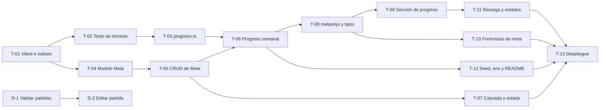

# Backlog de la épica E2: Metas y rachas

Fuentes: `docs/prd/prd-diario-gamer.md`, `docs/backlog/epicas.md` y `docs/diagnostico.md`.

**Objetivo de la épica.** Convertir el diario en una herramienta de constancia: meta semanal por videojuego, progreso de la semana, racha de días jugados e hitos de avance.

## Decisiones y supuestos

Decisiones tomadas para redactar este backlog:

- **Meta cumplida.** La semana está cumplida solo si se alcanzan las horas Y los días de la meta.
- **Editar una meta.** Se edita en el lugar la meta activa. Reemplazar una meta con historial (RN-12 y RN-13) es una acción aparte: se desactiva la meta y se crea una nueva. Crear una segunda meta activa sin desactivar la anterior se rechaza por conflicto.
- **Racha.** Se calcula por videojuego, porque el progreso semanal pertenece a cada juego.
- **Semana.** Va de lunes a domingo, en hora de Ecuador.
- **Hitos.** Su porcentaje se mide sobre el avance del videojuego (de 0 a 100), tomado de la última partida.

Estas decisiones cierran los puntos abiertos 1 y 5 del PRD y parte del 4. Falta reflejarlas en el PRD.

Puntos que siguen abiertos. Los criterios los tratan como valores por confirmar para no inventar reglas:

- Tolerancia de "fecha futura" (se propone 5 minutos).
- Límites permitidos de horas por semana. Los días van de 1 a 7.
- Qué pasa con los hitos al reemplazar una meta.

---

## 1. Historias de usuario

Cada historia incluye una nota INVEST (Independiente, Negociable, Valiosa, Estimable, Pequeña, Verificable).

### HU-01. Definir una meta semanal para un videojuego

**Como** jugador, **quiero** definir una meta semanal de horas y de días por semana para un videojuego, **para** tener un objetivo concreto que me ayude a jugar con constancia.

*INVEST:* es independiente y se puede entregar sola. Los valores concretos de la meta son negociables. Se verifica creando una meta y comprobando que queda activa. Es pequeña.

### HU-02. Ver mis horas y días jugados de la semana frente a la meta

**Como** jugador, **quiero** ver cuántas horas y cuántos días llevo jugados en la semana frente a mi meta, **para** saber si voy bien o si me falta jugar.

*INVEST:* necesita una meta (HU-01) y partidas ya registradas, y las declara como dependencia. Tiene valor directo y se verifica con ejemplos de semana concretos. Es acotada, porque no incluye racha ni hitos.

### HU-03. Ver mi racha actual y mi mejor racha

**Como** jugador, **quiero** ver cuántos días seguidos llevo jugando un videojuego y cuál fue mi mejor racha, **para** motivarme a no romper la cadena.

*INVEST:* es independiente de la meta, porque se calcula solo con las partidas. Tiene valor propio. Se verifica con fechas de ejemplo.

### HU-04. Ver qué hitos de avance he alcanzado

**Como** jugador, **quiero** definir hitos de avance para mi meta y ver cuáles ya alcancé, **para** celebrar el progreso y sentir que voy avanzando en el juego.

*INVEST:* depende de HU-01 porque los hitos pertenecen a una meta. Aun así aporta valor por sí sola. Los porcentajes de cada hito son negociables. Se verifica con avances de ejemplo.

### HU-05. Editar o desactivar mi meta

**Como** jugador, **quiero** editar o desactivar mi meta, y poder reemplazarla por otra sin perder la anterior, **para** adaptarla cuando cambia mi disponibilidad.

*INVEST:* depende de HU-01. Es una historia pequeña que se puede verificar con la meta antes y después del cambio.

### HU-06. Que mi meta se mantenga coherente si cambio o elimino el juego

**Como** jugador, **quiero** que mis metas se ajusten solas cuando termino, abandono o elimino un videojuego, **para** no quedarme con metas que ya no tienen sentido.

*INVEST:* depende de HU-01. Agrupa dos situaciones, el cambio de estado y la eliminación. Se mantiene en una sola historia porque ambas protegen la coherencia de las metas y son pequeñas. Si crece, se puede dividir.

---

## 2. Criterios de aceptación

Formato DADO / CUANDO / ENTONCES. La numeración es global. Todos los días y semanas se miden en hora de Ecuador.

### HU-01. Definir una meta semanal

**CA-01. Meta válida (RN-14)**
- **DADO** un videojuego en curso sin meta activa
- **CUANDO** el jugador define una meta de 5 horas por semana en 3 días por semana
- **ENTONCES** la meta queda activa para ese videojuego.

**CA-02. Valores de meta no válidos**
- **DADO** un videojuego en curso sin meta activa
- **CUANDO** el jugador intenta definir una meta con 0 horas, con horas negativas, con 0 días o con más de 7 días por semana
- **ENTONCES** la meta no se crea y se muestra un mensaje en español que indica qué valor corregir. El máximo de horas permitido está por confirmar.

**CA-03. Una sola meta activa por videojuego (RN-14)**
- **DADO** un videojuego que ya tiene una meta activa
- **CUANDO** el jugador intenta crear otra meta activa para ese mismo videojuego
- **ENTONCES** no se crea la segunda meta y se informa que ya existe una meta activa.

### HU-02. Ver mi progreso de la semana

**CA-04. Progreso de la semana en hora de Ecuador**
- **DADO** una meta activa de 5 horas en 3 días, y la semana actual de lunes a domingo, con partidas de 2 horas el lunes, 2 horas el miércoles y 1 hora el viernes
- **CUANDO** el jugador consulta su progreso semanal
- **ENTONCES** ve 5 horas y 3 días jugados de la semana, y la semana aparece cumplida. Si solo alcanzara las horas o solo los días, no aparecería cumplida. Las partidas de semanas anteriores no se suman.

**CA-05. Partida que cruza la medianoche (RN-03)**
- **DADO** una partida que empieza el domingo a las 23:30 y dura 90 minutos
- **CUANDO** el jugador consulta el progreso de esa semana
- **ENTONCES** la partida cuenta como jugada el domingo y sus 90 minutos cuentan completos en esa semana, sin pasar nada a la semana siguiente.

**CA-06. Meta superada (RN-05)**
- **DADO** una meta de 5 horas en 3 días, y una semana con 7 horas jugadas en 2 días
- **CUANDO** el jugador consulta su progreso
- **ENTONCES** el cumplimiento de horas se ve como 100%, las horas jugadas muestran 7 y la semana no aparece cumplida porque faltan días.

### HU-03. Ver mi racha

**CA-07. Racha viva si la última partida fue ayer (RN-01)**
- **DADO** un videojuego cuya última partida fue ayer y en el que hoy todavía no se juega
- **CUANDO** el jugador consulta su racha
- **ENTONCES** la racha actual sigue contando, sin volver a 0.

**CA-08. Racha rota por dos o más días sin jugar (RN-01)**
- **DADO** un videojuego cuya última partida fue anteayer o antes, y con una mejor racha de 6 días
- **CUANDO** el jugador consulta su racha
- **ENTONCES** la racha actual es 0 y la mejor racha se conserva en 6 días.

**CA-09. Varias partidas el mismo día (RN-02)**
- **DADO** un jugador con dos o más partidas el mismo día en un videojuego
- **CUANDO** el sistema calcula la racha y los días jugados de la meta
- **ENTONCES** ese día cuenta una sola vez, y los minutos de todas las partidas se suman a las horas de la semana.

**CA-10. Sin partidas**
- **DADO** un videojuego sin partidas registradas
- **CUANDO** el jugador consulta su racha
- **ENTONCES** la racha actual y la mejor racha son 0.

**CA-11. Racha que crece y mejor racha**
- **DADO** un videojuego con una racha actual igual a su mejor racha
- **CUANDO** el jugador registra una partida en un día nuevo que continúa la racha
- **ENTONCES** la racha actual sube en uno y la mejor racha se actualiza al mismo valor.

### HU-04. Ver mis hitos

**CA-12. Hito alcanzado**
- **DADO** una meta con un hito en 50% y un videojuego con avance de 60%
- **CUANDO** el jugador consulta sus hitos
- **ENTONCES** el hito aparece como alcanzado. Con un avance de exactamente 50% también aparece como alcanzado.

**CA-13. Hito pendiente**
- **DADO** una meta con un hito en 50% y un videojuego con avance de 30%
- **CUANDO** el jugador consulta sus hitos
- **ENTONCES** el hito aparece como pendiente.

**CA-14. Hito que vuelve a pendiente (RN-06)**
- **DADO** un hito en 50% que aparece alcanzado porque el avance es 60%
- **CUANDO** el jugador edita o borra partidas y el avance baja a 40%
- **ENTONCES** el hito vuelve a pendiente.

**CA-15. Hito ya superado al crearlo (RN-11)**
- **DADO** un videojuego con avance de 70%
- **CUANDO** el jugador crea un hito en 50%
- **ENTONCES** el hito se crea y aparece como alcanzado desde el primer momento.

**CA-16. Máximo de hitos (RN-10)**
- **DADO** una meta que ya tiene 5 hitos
- **CUANDO** el jugador intenta agregar un sexto hito
- **ENTONCES** el hito no se crea y se informa que el máximo es 5.

**CA-17. Porcentajes repetidos (RN-10)**
- **DADO** una meta con un hito en 50%
- **CUANDO** el jugador intenta agregar otro hito en 50%
- **ENTONCES** el segundo hito no se crea y se informa que ese porcentaje ya existe.

**CA-18. Orden de los hitos (RN-10)**
- **DADO** una meta con hitos que el jugador creó en distinto orden, por ejemplo 75%, 25% y 50%
- **CUANDO** el jugador consulta sus hitos
- **ENTONCES** los ve ordenados de menor a mayor: 25%, 50% y 75%.

### HU-05. Editar o desactivar la meta

**CA-19. Editar la meta activa**
- **DADO** un videojuego con una meta activa de 5 horas en 3 días
- **CUANDO** el jugador cambia la meta a 8 horas en 4 días
- **ENTONCES** la meta activa queda con los valores nuevos y sigue siendo la única meta activa del juego.

**CA-20. Cambio de meta a mitad de semana (RN-04)**
- **DADO** una semana en curso con 3 horas jugadas en 2 días y una meta activa de 5 horas
- **CUANDO** el jugador cambia la meta a 10 horas
- **ENTONCES** el progreso de la semana se muestra de inmediato contra la meta nueva, con todo lo jugado en la semana, es decir, 3 de 10 horas.

**CA-21. Desactivar con confirmación (RN-12)**
- **DADO** un videojuego con una meta activa
- **CUANDO** el jugador pide desactivarla
- **ENTONCES** la aplicación le pide confirmación y, al confirmar, la meta queda inactiva y se conserva en el historial del videojuego. Si cancela, la meta sigue activa.

**CA-22. Una meta desactivada no se reactiva (RN-13)**
- **DADO** una meta desactivada
- **CUANDO** el jugador quiere volver a jugar con meta
- **ENTONCES** no existe la opción de reactivar esa meta y el jugador debe crear una meta nueva.

**CA-23. Reemplazar una meta (RN-12)**
- **DADO** un videojuego con una meta activa
- **CUANDO** el jugador reemplaza esa meta por otra
- **ENTONCES** la meta anterior queda inactiva y visible en el historial, y la meta nueva queda activa.

### HU-06. Metas coherentes con el estado y la eliminación del juego

**CA-24. Sin meta en juego terminado o abandonado (RN-07)**
- **DADO** un videojuego completado o abandonado
- **CUANDO** el jugador intenta crear una meta activa
- **ENTONCES** la meta no se crea y se informa que el juego no está en curso.

**CA-25. Desactivación automática por cambio de estado (RN-07)**
- **DADO** un videojuego con una meta activa
- **CUANDO** el jugador cambia el videojuego a completado o abandonado
- **ENTONCES** la meta activa se desactiva automáticamente y queda en el historial.

**CA-26. Eliminar un juego con partidas (RN-08)**
- **DADO** un videojuego que tiene partidas, con o sin metas
- **CUANDO** el jugador intenta eliminarlo
- **ENTONCES** la eliminación se bloquea y se informa el motivo. El juego y sus metas se conservan.

**CA-27. Eliminar un juego sin partidas (RN-08)**
- **DADO** un videojuego sin partidas, con una meta activa y una meta inactiva
- **CUANDO** el jugador lo elimina
- **ENTONCES** el juego se elimina junto con todas sus metas, activas e inactivas.

### Calidad de las partidas

Estos criterios se entregan en las deudas D-1 y D-2 (fase 8). Mientras no estén listos, las reglas de progreso y racha asumen partidas válidas.

**CA-28. Duración mayor que 0 (RN-09)**
- **DADO** un jugador que registra o edita una partida
- **CUANDO** indica una duración de 0 minutos
- **ENTONCES** la partida no se guarda y se muestra un mensaje en español.

**CA-29. Sin fecha futura (RN-09)**
- **DADO** un jugador que registra o edita una partida
- **CUANDO** indica una fecha posterior al momento actual, más allá de la tolerancia por confirmar
- **ENTONCES** la partida no se guarda y se muestra un mensaje en español.

**CA-30. Editar una partida recalcula todo (RN-04 y RN-06)**
- **DADO** un videojuego con partidas, una meta activa, una racha y hitos
- **CUANDO** el jugador corrige una partida, por ejemplo su duración o su fecha
- **ENTONCES** el progreso semanal, la racha y el estado de los hitos se muestran de inmediato con el dato corregido.

### Cobertura de reglas de negocio

| Regla | Criterios que la cubren |
|---|---|
| RN-01 Racha y día de hoy | CA-07, CA-08, CA-10, CA-11 |
| RN-02 Varias partidas el mismo día | CA-09 |
| RN-03 Cruza la medianoche | CA-05 |
| RN-04 Cambio de meta a mitad de semana | CA-20, CA-30 |
| RN-05 Meta superada | CA-06 |
| RN-06 Hito ya alcanzado | CA-14, CA-30 |
| RN-07 Juego completado o abandonado | CA-24, CA-25 |
| RN-08 Eliminar videojuego con meta | CA-26, CA-27 |
| RN-09 Partidas válidas | CA-28, CA-29 |
| RN-10 Hitos de una meta | CA-16, CA-17, CA-18 |
| RN-11 Hito ya superado al crearlo | CA-15 |
| RN-12 Reemplazar una meta | CA-21, CA-23 |
| RN-13 Meta desactivada | CA-22 |
| RN-14 Una meta activa por videojuego | CA-01, CA-03 |

---

## 3. Tickets de implementación

### Definition of Done general

Un ticket se considera terminado cuando cumple todo lo siguiente:

- Los criterios de aceptación que cubre están cumplidos.
- El test se escribió antes del código y está en verde, con commits separados: primero `test (E2): T-xx` y luego `feat (E2): T-xx`.
- `npm run check` pasa sin errores.
- El commit lleva el id del ticket y la caja del ticket está marcada en este backlog.

Cada ticket añade su propia Definition of Done específica.

### Dependencias

T-13 depende de todos los tickets T-01 a T-12. En el diagrama solo se dibujan las dependencias directas. D-1 y D-2 son de la fase 8 y van después del despliegue, según el orden del diagnóstico.

### Tickets

- [ ] **T-01 | chore | Vitest, script npm test y sincronización de índices**
  - **Resumen:** agregar la herramienta de pruebas al backend, el script `npm test` y una forma explícita de crear los índices en la base de datos, manteniendo la creación automática desactivada. Cubre H01 y H03 del diagnóstico.
  - **Cubre:** ninguno directamente. Habilita la verificación de todos los criterios.
  - **Definition of Done:**
    - `npm test` corre y pasa con al menos una prueba de ejemplo.
    - Hay una forma documentada de sincronizar los índices.
    - La creación automática de índices sigue desactivada.
  - **Depende de:** -
  - **Nota:** requiere permiso para agregar la dependencia de pruebas, según las reglas del proyecto.

- [ ] **T-02 | test | Tests de las funciones de dominio (semana, días, racha, hitos)**
  - **Resumen:** escribir primero las pruebas del cálculo puro: semana de lunes a domingo en hora de Ecuador, días jugados únicos, racha actual y mejor racha, y estado de los hitos. También cubre la zona horaria `America/Guayaquil` y las fechas ISO con zona (H10).
  - **Cubre:** CA-04 a CA-11 y CA-14.
  - **Definition of Done:**
    - Hay pruebas para cada criterio que cubre, incluidos los casos de CA-07, CA-08 y CA-09.
    - Hay casos de partida que cruza la medianoche y de cambio de semana.
    - Las pruebas fallan por la razón correcta, porque el código aún no existe, y se confirman con un commit propio.
  - **Depende de:** T-01

- [ ] **T-03 | feat | src/dominio/progreso.ts hasta que T-02 pase**
  - **Resumen:** implementar el cálculo puro de progreso, racha y hitos, sin acceso a la base de datos, hasta que todas las pruebas de T-02 pasen.
  - **Cubre:** CA-04 a CA-11 y CA-14.
  - **Definition of Done:**
    - Todas las pruebas de T-02 pasan sin modificarlas.
    - El módulo no importa nada de la capa de datos.
    - `npm run check` sin errores.
  - **Depende de:** T-02

- [ ] **T-04 | feat | Modelo Meta con validaciones e índice único parcial**
  - **Resumen:** crear el modelo de meta con horas, días, estado activo o inactivo y hitos. Incluye las validaciones de rango y un índice único parcial que impide dos metas activas para el mismo videojuego.
  - **Cubre:** CA-02, CA-16, CA-17 y CA-18.
  - **Definition of Done:**
    - Pruebas del modelo: valores inválidos, más de 5 hitos, porcentajes repetidos y hitos guardados de menor a mayor.
    - El índice único parcial se crea con la sincronización de T-01.
    - Los mensajes de validación están en español.
  - **Depende de:** T-01

- [ ] **T-05 | feat | CRUD de Meta, 409 por meta duplicada y errorHandler con 11000 -> 409**
  - **Resumen:** crear, consultar, editar y desactivar metas. Una segunda meta activa responde conflicto. El manejador de errores traduce el código 11000 a 409 sin exponer datos internos (H04).
  - **Cubre:** CA-01, CA-03, CA-15, CA-19, CA-21, CA-22, CA-23 y CA-24.
  - **Definition of Done:**
    - Pruebas de creación, edición, desactivación y consulta del historial.
    - Una segunda meta activa devuelve 409 con un mensaje en español.
    - No existe operación para reactivar una meta desactivada.
    - Crear una meta en un juego completado o abandonado se rechaza.
  - **Depende de:** T-04

- [ ] **T-06 | feat | GET /api/videojuegos/:id/progreso-semanal**
  - **Resumen:** devolver el progreso de la semana actual, la racha actual, la mejor racha y el estado de los hitos de un videojuego, usando el cálculo puro de T-03 y la meta activa.
  - **Cubre:** CA-04 a CA-14, CA-20 y CA-30 (la parte de lectura).
  - **Definition of Done:**
    - Pruebas con partidas y meta reales de ejemplo.
    - La respuesta incluye horas reales sin tope y el cumplimiento limitado a 100%.
    - Identificador inválido responde 400 y videojuego inexistente responde 404.
    - Un juego sin meta responde sin error y sin progreso de meta, y la racha se calcula igual.
  - **Depende de:** T-03, T-05

- [ ] **T-07 | feat | Cascada al eliminar videojuego y desactivación por estado**
  - **Resumen:** al eliminar un videojuego sin partidas, eliminar todas sus metas. Si el videojuego tiene partidas, mantener el bloqueo. Al pasar un videojuego a completado o abandonado, desactivar su meta activa.
  - **Cubre:** CA-25, CA-26 y CA-27.
  - **Definition of Done:**
    - Pruebas: eliminación con partidas bloqueada, eliminación sin partidas con metas activas e inactivas, y cambio de estado con meta activa.
    - Tras la eliminación no quedan metas huérfanas.
    - La política actual de eliminación de partidas no cambia.
  - **Depende de:** T-05

- [ ] **T-08 | feat | metasApi.ts y tipos del frontend**
  - **Resumen:** capa del frontend para consumir metas y el progreso semanal, con sus tipos. Usa el cliente de la aplicación como único punto de peticiones.
  - **Cubre:** ninguno directamente. Habilita HU-02, HU-03, HU-04 y HU-05 en pantalla.
  - **Definition of Done:**
    - Tipos alineados con la respuesta del servidor.
    - Funciones para crear, editar, desactivar, listar el historial y obtener el progreso.
    - `npm run check` y `npm run build` del frontend sin errores.
  - **Depende de:** T-06

- [ ] **T-09 | feat | Sección de progreso semanal**
  - **Resumen:** sección en el detalle del videojuego con horas y días de la semana frente a la meta, cumplimiento limitado a 100%, racha actual, mejor racha e hitos alcanzados y pendientes. Usa la identidad visual de `DESIGN.md`.
  - **Cubre:** CA-04 a CA-14 en pantalla.
  - **Definition of Done:**
    - La sección muestra los valores del servidor sin recalcularlos.
    - Las horas jugadas muestran el valor real aunque el porcentaje sea 100%.
    - Cumple `DESIGN.md`: sin colores ni librerías no autorizadas.
    - Respeta `prefers-reduced-motion`.
  - **Depende de:** T-08

- [ ] **T-10 | feat | Formulario de meta con hitos y desactivar con confirmación**
  - **Resumen:** formulario para crear y editar la meta con sus hitos, acción de reemplazar y desactivar con confirmación previa.
  - **Cubre:** CA-01, CA-02, CA-15 a CA-19 y CA-21 a CA-23 en pantalla.
  - **Definition of Done:**
    - El formulario muestra los errores del servidor en español.
    - No hay botón para reactivar metas inactivas.
    - Desactivar pide confirmación y cancelar no cambia nada.
    - Los hitos se muestran ordenados de menor a mayor.
  - **Depende de:** T-08

- [ ] **T-11 | feat | Recarga del progreso al cambiar partidas y estados de carga, error y vacío**
  - **Resumen:** recargar el progreso cuando el jugador crea, borra o edita partidas o cambia el estado del juego. Incluye estados de carga, error y vacío (sin meta o sin partidas).
  - **Cubre:** CA-14, CA-20 y CA-30 en pantalla.
  - **Definition of Done:**
    - Tras cambiar una partida, el progreso, la racha y los hitos se actualizan sin recargar la página.
    - Hay estado de carga, de error con opción de reintentar y de vacío.
    - Al editar la meta, el progreso se actualiza de inmediato.
  - **Depende de:** T-09

- [ ] **T-12 | chore | Seed de demo, .env.example y README**
  - **Resumen:** datos de demostración con metas, partidas, rachas e hitos; `.env.example` con solo nombres de variables, incluida la lista blanca de CORS; y sección "Cómo ejecutar" en el README. Cubre H13 y H15 del diagnóstico.
  - **Cubre:** ninguno directamente.
  - **Definition of Done:**
    - Una persona nueva puede instalar, cargar los datos de demo y ver una meta con progreso siguiendo solo el README.
    - `.env.example` no contiene valores secretos. No se lee ni modifica ningún archivo `.env`.
    - El origen permitido por CORS se configura por variable y nunca es `*`.
  - **Depende de:** T-06

- [ ] **T-13 | ops | Despliegue en Render**
  - **Resumen:** publicar el backend y el frontend en Render con las variables configuradas desde el panel de la plataforma. Incluye la configuración de CORS y la verificación en producción.
  - **Cubre:** ninguno directamente. Verifica la épica completa en producción.
  - **Definition of Done:**
    - Los dos servicios están publicados y se comunican entre sí.
    - La ruta de salud responde correctamente.
    - Se verifica de punta a punta: crear una meta, registrar una partida y ver el progreso.
    - Ninguna variable secreta queda en el repositorio.
  - **Depende de:** todos (T-01 a T-12)

- [ ] **D-1 | fix | Validar duración > 0 y fecha no futura en partidas (fase 8)**
  - **Resumen:** rechazar partidas con duración 0 o negativa y con fecha futura, con mensajes en español, en el servicio y en el modelo para que D-2 las reutilice. Cubre H06 y la parte de fecha futura de H07.
  - **Cubre:** CA-28 y CA-29.
  - **Definition of Done:**
    - Pruebas primero: duración 0, negativa y válida; fecha pasada, presente, futura y dentro de la tolerancia.
    - Las respuestas son 400 con mensaje en español.
    - Queda fuera del alcance: máximo de duración y entero obligatorio.
  - **Depende de:** -

- [ ] **D-2 | fix | Editar partida PATCH /api/partidas/:id y formulario (fase 8)**
  - **Resumen:** editar fecha, duración, avance y notas de una partida, reutilizando las validaciones de D-1. Incluye la ruta de edición en el frontend y el botón Editar en el listado. La partida no cambia de videojuego.
  - **Cubre:** CA-30 y CA-14 desde la edición.
  - **Definition of Done:**
    - Pruebas primero: edición válida, campo no permitido, identificador inválido, identificador inexistente y validaciones de D-1.
    - Tras editar, el resumen, la racha y los hitos se recalculan.
    - El formulario reutiliza el de crear partida en modo edición.
  - **Depende de:** D-1

---

## 4. Deuda técnica

Hallazgos del diagnóstico que no bloquean E2 y se difieren de forma consciente. Ninguno se resuelve dentro de la épica.

| Hallazgo | Descripción | Motivo para diferirlo | Cuándo reconsiderarlo |
|---|---|---|---|
| H02 | Scripts de `package.json` (`diagnostico`, `seed`, `validar-modelos`) que apuntan a archivos que no existen. | No afecta a E2 ni a los datos. T-12 crea solo el seed de demo. Los otros dos scripts siguen sin archivo. | Cuando haya una necesidad real, o al limpiar el proyecto. |
| H05 | Se pueden crear videojuegos duplicados (mismo nombre y plataforma). | Es una decisión de producto. | Cuando se decida. Se apoya en T-01 y en el manejo del error 11000 de T-05. |
| H06 residual | La duración no tiene máximo y no se exige que sea un número entero. | D-1 solo pide duración mayor que 0. El tope es una decisión de negocio. | Si aparecen duraciones absurdas en los datos. |
| H08 | El avance se valida solo en el modelo, con mensajes en inglés y sin exigir entero. | El rango ya se cumple. Es un tema de mensajes. | Al unificar los mensajes de error. |
| H09 | Los límites de longitud de textos existen solo en el frontend. | El tamaño del cuerpo de las peticiones ya está acotado. | Si se abre la API a otros clientes. |
| H11 | La política de eliminación es restrictiva: un videojuego con partidas no se borra y las partidas se borran una por una. | RN-08 la amplía solo para las metas. Pasar a cascada total o borrado lógico es decisión de producto. | Si el jugador necesita borrar juegos con historial. |
| H12 | Los logros se identifican por nombre y el nombre no es único. | Fuera del alcance de E2. | Cuando se trabaje en logros. |
| H14 | Colores fijos de Tailwind en el código heredado de P3: tema oscuro único, colores repetidos en clases y sombras con valores arbitrarios (unas 80 líneas en 9 archivos). | El rediseño visual no está en E2 y migrar a tokens toca muchos archivos. Las pantallas nuevas de E2 siguen `DESIGN.md`. | Cuando se aborde un rediseño o un tema claro. |
| H16 | Resumen y listados sin optimizar y redondeo del avance sin documentar. | El volumen de datos es pequeño. | Si E2 hace crecer el volumen o las pantallas se vuelven lentas. |
| H17 | Plataformas, géneros y estados repetidos entre backend y frontend, y un ícono repetido en dos pantallas. | Solo duele si cambian esas listas. | Al cambiar los valores permitidos. |
| H18 | Sin autenticación, limitación de peticiones ni cabeceras de seguridad. | Es una aplicación de un solo jugador. | Si el despliegue en Render es público. |
| H20 | La pantalla de detalle del videojuego concentra resumen, logros y partidas en unas 350 líneas y recarga todo tras cada cambio. | Refactorizar no aporta a E2. T-09 solo agrega su sección sin reorganizar la pantalla. | Cuando una historia concreta toque esa pantalla de forma sustancial. |
