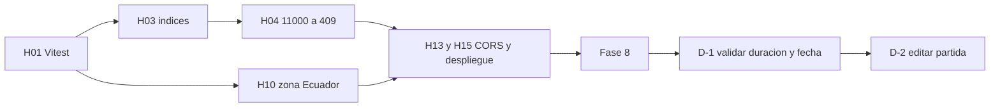

# Diagnóstico del Proyecto 3: Diario de Progreso Gamer

## 1. Contexto y criterio

Este documento resume el estado del Proyecto 3 antes de empezar la épica E2 y decide qué se resuelve, qué se paga como deuda técnica y qué se difiere.

- **Qué se revisó:** `backend/src`, `frontend/src`, `README.md` y `backend/package.json`.
- **Estado de compilación:** `npm run check` (backend) y `npm run build` (frontend) pasan sin errores. Eso solo comprueba tipos; no hay pruebas.
- **Restricción:** no se abrieron archivos `.env`. Toda la evidencia sale del código versionado.
- **Alcance de E2:** calidad del backend, nuevas funcionalidades (progreso y rachas) y despliegue. El rediseño visual queda fuera.
- **Criterio de "bloquea":** un hallazgo bloquea E2 si impide construir o verificar una historia de E2 con confianza.
- **Evidencia:** se cita como `archivo:línea`, con rutas relativas a la raíz del repositorio. Los números de línea corresponden al estado actual del código y pueden moverse al editar.

Cada hallazgo tiene una sola decisión:

1. **Ticket principal de E2:** bloquea E2 y se resuelve dentro de los tickets principales.
2. **Deuda D-1 o D-2:** se paga en la Fase 8, cada una con su propio ciclo de test y commit.
3. **DIFERIDO:** queda registrado con su motivo y no se toca en E2.

## 2. Estado del Proyecto 3

### 2.1 Organización

- **Backend** (Express 4, Mongoose 8, TypeScript): capas `routes → controllers → services → modelos`.
  - Middlewares: `requestId`, `logger` y `errorHandler` (`backend/src/middlewares/`).
  - `config/env.ts` es el único lugar que lee el entorno.
  - `conexionDB.ts` abre un pool por proceso.
  - `validacion.ts` y `apiError.ts` son helpers transversales.
- **Frontend** (React 18, Vite, Tailwind 4, GSAP, lucide):
  - Capa `api/` con `cliente.ts` como único punto de `fetch`.
  - Cinco páginas en `paginas/`.
  - Estilos compartidos en `utils/estilos.ts`.
  - Proxy `/api` de Vite hacia `127.0.0.1:3000` (`frontend/vite.config.ts:2`).
- **Modelo de datos:**
  - `Videojuego` con `logros` embebidos.
  - `Partida` referenciada a `Videojuego`, con el índice `{ videojuego: 1, fecha: -1 }`.

### 2.2 Qué funciona

- CRUD de videojuegos y filtro por estado, plataforma o género.
- Alta, listado y borrado de partidas.
- Resumen calculado al leer: total de partidas, horas totales, última partida y avance actual.
- Logros: agregar, marcar como obtenido y quitar.
- Entrada saneada:
  - Lista blanca de campos (`validacion.ts`).
  - `idValido` para los identificadores.
  - `queryTexto` contra operadores en la query.
  - Límite de body de 32 kb (`backend/src/app.ts:11`).
- Operación:
  - `/api/salud` (`app.ts:12`).
  - `X-Request-Id` en cada respuesta.
  - Logs en JSON sin la URI de la base de datos.
  - Cierre ordenado ante `SIGINT` y `SIGTERM`.
- UI con estados de carga, error y vacío, confirmación antes de eliminar y respeto de `prefers-reduced-motion`.

### 2.3 Qué falta

- Pruebas automáticas.
- Índices realmente creados en la base de datos.
- Manejo del error 11000 (duplicado).
- Validación de duración y fecha de la partida.
- Edición de partidas.
- Zona horaria explícita.
- CORS y preparación del despliegue.
- Documentación de ejecución, de la política de eliminación y del contrato de fechas.

## 3. Tabla de hallazgos

### 3.1 Grupo 1: bloquean E2 (se resuelven dentro de los tickets principales de E2)

| id | hallazgo | evidencia | impacto en E2 | decisión y motivo |
|---|---|---|---|---|
| H01 | No hay pruebas. `check` y `build` solo verifican tipos. | `backend/package.json:5-13` y `frontend/package.json:6-11` no tienen script `test`. No hay archivos `*.test.*` ni dependencias de vitest, jest o supertest. | **Bloquea**: los criterios de aceptación de E2 no son verificables. | **Ticket E2 (Vitest en backend).** Es la base de los ciclos de test de D-1 y D-2. |
| H03 | `autoIndex: false` hace que el índice declarado nunca se cree, y el README afirma que existe. | `backend/src/conexionDB.ts:8`, `backend/src/modelos/Partida.model.ts:27`, `README.md:30`. No hay `syncIndexes` ni `createIndexes` en `src`. | **Bloquea**: cualquier índice, incluido uno único, queda inerte. | **Ticket E2.** Crear los índices de forma explícita (script o `SYNC_INDEXES=1`). Mantener `autoIndex: false`, que es lo correcto en producción. |
| H04 | El error 11000 (clave duplicada) no se maneja y saldría como 500. | `backend/src/middlewares/errorHandler.ts:7-12` solo cubre `ApiError`, validación, cast, strict mode y JSON malformado. Hoy es latente porque no hay índices únicos. | **Bloquea**: toda unicidad que E2 agregue respondería 500. | **Ticket E2.** Mapear `code === 11000` a 409 sin exponer `keyValue`. Va junto con H03. |
| H10 | Zona horaria sin contrato explícito. La UI convierte local a UTC bien, pero el formato fija la localidad sin zona y el backend acepta fechas sin zona. | `frontend/src/utils/formato.ts:2` usa `'es-EC'` sin `timeZone`. `formato.ts:7-9` y `frontend/src/paginas/PartidaForm.tsx:79` convierten local a UTC. `backend/src/services/partidas.service.ts:36` interpreta cadenas sin zona con la hora del servidor. | **Bloquea**: las rachas necesitan agrupar por día, y el día depende de la zona. | **Ticket E2 (zona Ecuador).** Fijar `America/Guayaquil` (UTC-5, sin horario de verano) en formato y agrupación por día. El backend debe exigir ISO 8601 con zona. Documentar el contrato: UTC en base de datos y Ecuador en la UI. |
| H13 | No hay CORS. En desarrollo funciona solo por el proxy de Vite. | `backend/src/app.ts:10-16` sin middleware. `backend/package.json` sin dependencia `cors`. `vite.config.ts:2` (proxy). `frontend/src/api/cliente.ts:1` (`VITE_API_URL`). El preflight de PUT, PATCH y DELETE caería en el 404 de `app.ts:15`. | **Bloquea** el despliegue con orígenes distintos. | **Ticket E2 (despliegue).** Lista blanca por `CORS_ORIGIN`, nunca `*`. Alternativa sin CORS: proxy o rewrite de `/api` en el hosting. |
| H15 | El despliegue no está preparado. | No existe `.env.example`, aunque `.gitignore:4` lo permite. El README no explica instalación, ejecución ni variables. `backend/src/index.ts:6` hace `listen(port)` sin host y el log dice `127.0.0.1`. `backend/package.json:2` y `frontend/package.json:2` usan los nombres `pawnee-api` y `pawnee-web`. `start` exige `build` previo (`backend/package.json:8-9`). | **Bloquea** el despliegue y la puesta en marcha por otra persona. | **Ticket E2 (despliegue).** `.env.example` con solo nombres de variables, sección "Cómo ejecutar" en el README, host configurable y nombres corregidos. Dockerfile y CI solo cuando se elija la plataforma. |

Nota: la parte de H07 que exige fecha ISO con zona se cubre dentro del ticket de H10. La parte de fecha futura va a D-1.

### 3.2 Grupo 2: deudas técnicas pagadas en la Fase 8

| id | hallazgo | evidencia | impacto en E2 | decisión y motivo |
|---|---|---|---|---|
| H06 / H07 (parte) | La partida acepta duración 0 y fechas futuras. Una fecha futura queda como "última partida" y fija el avance actual. | `backend/src/services/partidas.service.ts:34` solo rechaza `duracion < 0`. `backend/src/modelos/Partida.model.ts:19` no tiene `min`. `partidas.service.ts:36-37` y `Partida.model.ts:18` sin tope de fecha. `backend/src/services/videojuegos.service.ts:104-107` toma `partidas[0]` ordenado por fecha como la última. | No bloquea E2, pero contamina `horasTotales` y `porcentajeAvanceActual`, de los que dependen progreso y rachas. | **Pagar en Fase 8: D-1.** Ver ficha en la sección 4. |
| H19 | No existe la edición de partidas, ni en el backend ni en el frontend. | Ver detalle debajo de la tabla. | No bloquea el arranque de E2, pero sin editar no se puede corregir una partida mal cargada, y el progreso y las rachas se derivan de ellas. | **Pagar en Fase 8: D-2.** Ver ficha en la sección 4. |

Evidencia de H19:

- **Backend:**
  - `backend/src/routes/partidas.routes.ts:6-8` solo tiene `GET /`, `POST /` y `DELETE /:id`.
  - `backend/src/controllers/partidas.controller.ts:4,12,20` solo tiene `listar`, `crear` y `eliminar`.
  - `backend/src/services/partidas.service.ts:13,17,23,52` no tiene ninguna función de actualización.
- **Frontend:**
  - `frontend/src/api/partidasApi.ts:30-36` no tiene `actualizar`.
  - `frontend/src/App.tsx:56-57` solo define `/partidas` y `/partidas/nueva`.
  - `frontend/src/paginas/PartidaForm.tsx:2,26,118` usa `useSearchParams` y el título fijo "Nueva partida", sin `useParams` ni modo edición.
  - `frontend/src/paginas/PartidasList.tsx:61` solo tiene el botón Eliminar.
- **Patrón a reutilizar:** `frontend/src/paginas/VideojuegoForm.tsx:30-32,86` ya resuelve crear y editar en un solo formulario.

### 3.3 Grupo 3: DIFERIDO

| id | hallazgo | evidencia | impacto en E2 | decisión y motivo |
|---|---|---|---|---|
| H02 | Scripts npm fantasma: apuntan a archivos que no existen. | `backend/package.json:10-12` (`diagnostico`, `seed`, `validar-modelos` apuntan a `scripts/*.ts`; la carpeta `backend/scripts/` no existe). | No bloquea. | **DIFERIDO.** No afecta a E2 ni a los datos. Se limpia o se crea cuando haya necesidad real, por ejemplo un `seed` para demos. |
| H05 | Se pueden crear videojuegos duplicados (mismo nombre y plataforma). | `backend/src/modelos/Videojuego.model.ts:35-44` sin índice único. `backend/src/services/videojuegos.service.ts:62-70`. | No bloquea. | **DIFERIDO.** Es una decisión de producto. Cuando se tome, se apoya en H03 y H04. |
| H06 residual | `duracionMinutos` sin máximo y sin exigir entero. | `backend/src/modelos/Partida.model.ts:19`. | No bloquea. | **DIFERIDO.** D-1 solo pide `> 0`. Un tope y el entero son decisiones de negocio. |
| H08 | `porcentajeAvance` se valida solo en Mongoose, con mensajes en inglés y sin exigir entero. | `backend/src/modelos/Partida.model.ts:20`. `backend/src/services/partidas.service.ts:33` sin chequeo de rango. `errorHandler.ts:9` devuelve `err.message`. | No bloquea. | **DIFERIDO.** El rango ya se hace cumplir; es un tema de mensajes. |
| H09 | Límites de longitud solo en el frontend. | `frontend/src/paginas/PartidaForm.tsx:196` (notas, 500), `frontend/src/paginas/VideojuegoForm.tsx:124` y `frontend/src/paginas/VideojuegoDetail.tsx:257` (120). Los modelos solo usan `trim` (`Partida.model.ts:21`, `Videojuego.model.ts:31,37`). | No bloquea. | **DIFERIDO.** El body ya está acotado a 32 kb (`app.ts:11`). |
| H11 | La política de eliminación es restrictiva y no estaba documentada. | `backend/src/services/videojuegos.service.ts:80-90` rechaza con 409 si hay partidas. `backend/src/services/partidas.service.ts:52-56` borra de forma definitiva. Condición de carrera entre `videojuegos.service.ts:85` y `:88`. `frontend/src/paginas/PartidasList.tsx:99` ya tolera partidas huérfanas. | No bloquea. | **DIFERIDO.** Pasar a cascada o borrado lógico es decisión de producto. La política vigente funciona y queda descrita aquí: un videojuego con partidas no se puede borrar, y las partidas se borran una por una. |
| H12 | Los logros se identifican por nombre y el nombre no es único. | `backend/src/services/videojuegos.service.ts:126` permite duplicados. `:137` (`$pull`) borra todos los homónimos. `:150` (`logros.$`) toca solo el primero. `frontend/src/paginas/VideojuegoDetail.tsx:283` usa `_id` como key, pero opera por nombre en `:294` y `:302`. | No bloquea. | **DIFERIDO.** Fuera del alcance de E2. Se registra en el backlog. |
| H14 | Colores fijos de P3: tema oscuro único, colores repetidos en clases y sombras con valores arbitrarios. | `frontend/src/index.css:3-12`. `frontend/src/utils/estilos.ts:1-51`. Unas 80 líneas con clases de color en 9 archivos. Sin `@theme` ni `dark:`. La caja de error se repite en `PartidaForm.tsx:204`, `PartidasList.tsx:83`, `VideojuegoDetail.tsx:269`, `VideojuegosList.tsx:122`, `VideojuegoForm.tsx:173` y `components/EstadoCarga.tsx:5`. | No bloquea. | **DIFERIDO.** El rediseño visual no está en E2 y migrar a tokens toca muchos archivos. |
| H16 | Resumen y listados sin optimizar, y redondeo sin documentar. | `README.md:39` no menciona el redondeo de `videojuegos.service.ts:113`. `videojuegos.service.ts:104` carga todas las partidas en memoria. `partidas.service.ts:14` lista todo con `populate` y sin paginar. | No bloquea. | **DIFERIDO.** El volumen es pequeño. Se revisa si E2 lo hace crecer. |
| H17 | Contrato duplicado entre backend y frontend. | `Videojuego.model.ts:4-6` y `frontend/src/api/videojuegosApi.ts:4-6` repiten plataformas, géneros y estados. `iconoPlataforma` está repetido en `VideojuegosList.tsx:23` y `VideojuegoDetail.tsx:48`. | No bloquea. | **DIFERIDO.** Deuda de mantenimiento que solo duele si cambian los enums. |
| H18 | No hay autenticación, limitación de peticiones ni `helmet`. | `backend/src/app.ts:10-16`. | No bloquea. | **DIFERIDO.** Es una app de un solo usuario. Se reevalúa si el despliegue es público. |
| H20 | `VideojuegoDetail.tsx` concentra demasiadas responsabilidades: resumen, logros y partidas en unas 350 líneas. Tras cada cambio de logro vuelve a pedir videojuego, resumen y partidas. | `frontend/src/paginas/VideojuegoDetail.tsx:130,140,155` (`setDatos(await cargar())`). | No bloquea. | **DIFERIDO.** Refactorizar no aporta a E2, y D-2 no lo exige porque la edición vive en `PartidaForm` y `PartidasList`. Se hace cuando una historia concreta toque esta pantalla. |

## 4. Fichas de las deudas técnicas (Fase 8)

Cada deuda se paga con su propio ciclo: primero las pruebas, luego la implementación y al final un commit propio.

### D-1: validar duración y fecha de la partida

- **Cubre:** H06 y la parte de fecha futura de H07.
- **Alcance:** rechazar `duracionMinutos <= 0` y fechas futuras. La validación va en el servicio y en el modelo, para que D-2 la reutilice.
- **Respuesta:** 400 con mensaje en español.
- **Pruebas (primero):**
  - Duración: 0, negativa y válida.
  - Fecha: pasada, presente y futura.
  - Fecha dentro de la tolerancia aceptada.
- **Fuera de alcance:** tope máximo de duración, entero obligatorio y `maxlength` (ver H06 residual, H08 y H09 en DIFERIDO).

### D-2: edición de partidas

- **Cubre:** H19.
- **Backend:**
  - `PATCH /api/partidas/:id` con actualización parcial por lista blanca: `fecha`, `duracionMinutos`, `porcentajeAvance` y `notas`.
  - Reutiliza las validaciones de D-1 y usa `runValidators`.
  - Responde 404 si la partida no existe.
- **Frontend:**
  - `partidasApi.actualizar`.
  - Ruta `/partidas/:id/editar`.
  - `PartidaForm` con modo crear o editar, siguiendo el patrón de `VideojuegoForm.tsx`.
  - Botón Editar en `PartidasList`.
- **Recalcular al editar:** el resumen se calcula al leer (`backend/src/services/videojuegos.service.ts:104-113`), así que no hay datos derivados guardados. Basta con que el frontend recargue el resumen. Las rachas, cuando se construyan en E2, usarán la misma lectura. Las pruebas lo verifican.
- **Dependencia:** va después de D-1 para no duplicar la validación.
- **Pruebas (primero):**
  - PATCH válido.
  - Campo no permitido.
  - Identificador inválido.
  - Identificador inexistente.
  - Validaciones de D-1 al editar.
  - Resumen recalculado tras editar.

## 5. Orden de ejecución

## 6. Supuestos y preguntas abiertas

- **Tolerancia de "fecha futura" en D-1:** se propone 5 minutos por la diferencia de reloj entre cliente y servidor. Por confirmar.
- **Videojuego al editar (D-2):** se asume que no se puede cambiar el videojuego de una partida existente. Por confirmar.
- **Rachas:** todavía no existen en el código. D-2 deja las partidas editables y E2 construye las rachas sobre esa lectura.
- **Hosting:** la plataforma no está definida. Dockerfile y CI quedan dentro del ticket de despliegue solo cuando se elija.
